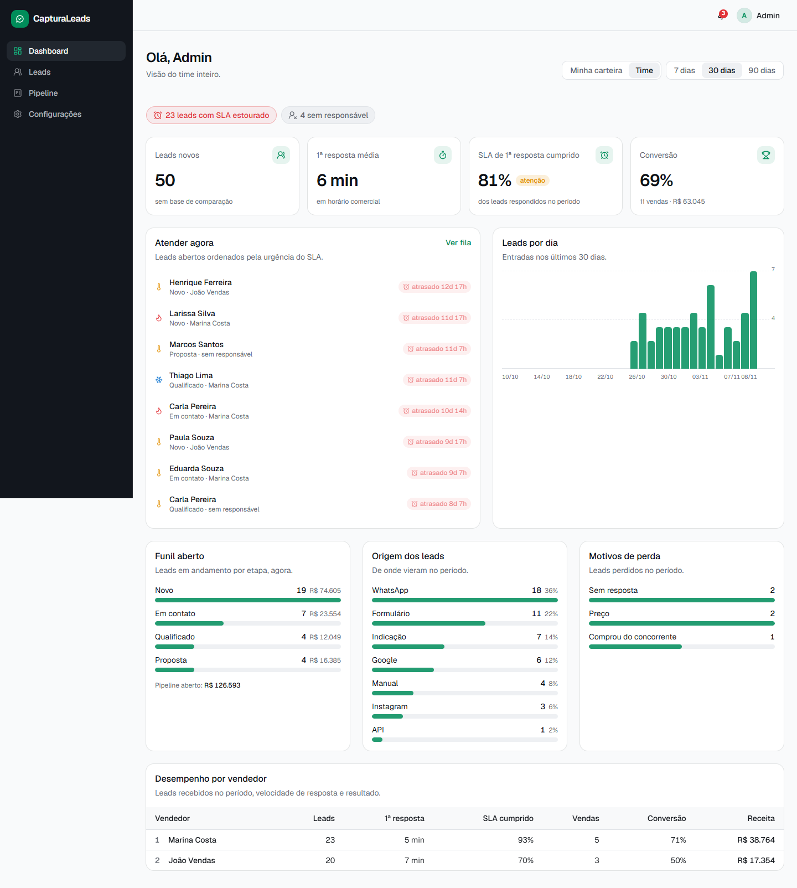
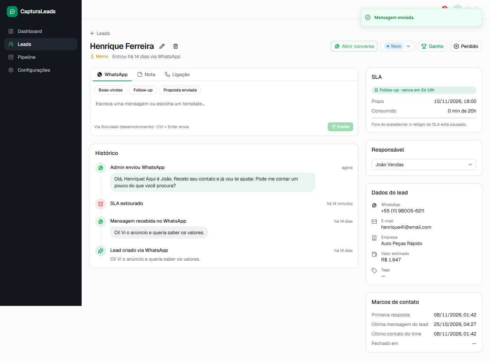
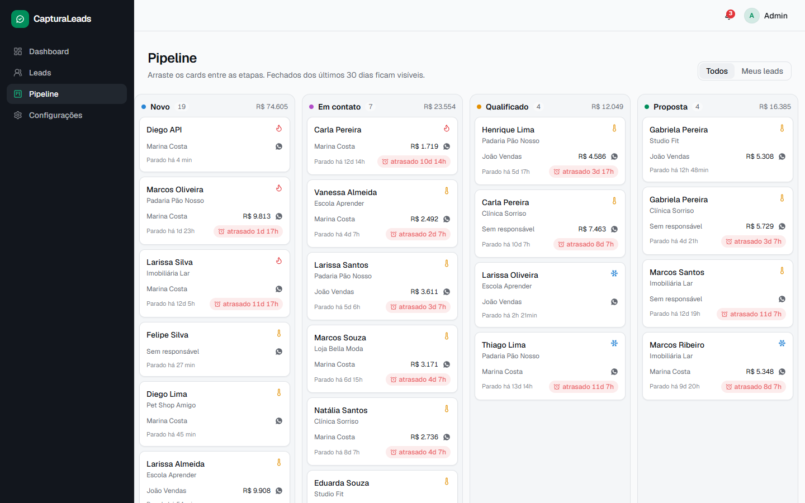
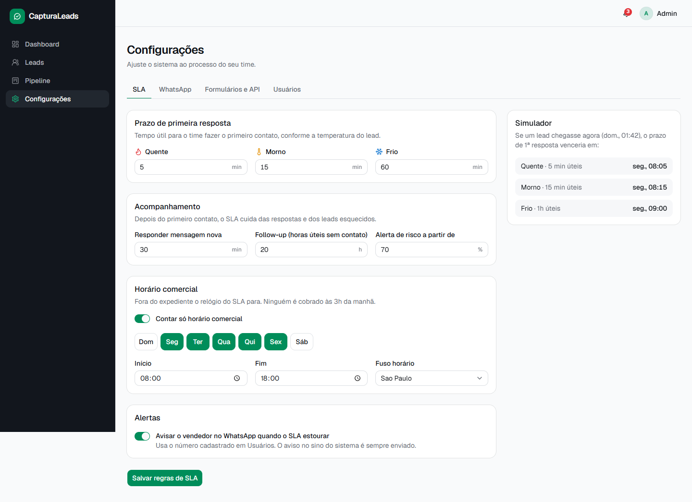
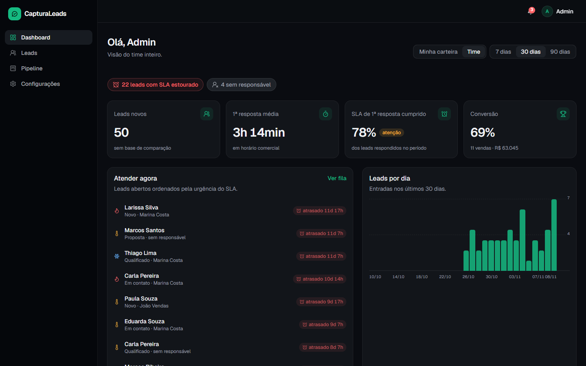

# CapturaLeads

CRM enxuto de captura e gestão de leads para times de vendas que vivem no WhatsApp.

Os leads entram pelo **WhatsApp**, por **formulários públicos** ou pela **API**. Um **motor de SLA**
com horário comercial avisa quando alguém está esperando demais, e o vendedor atende tudo de uma tela só.



## Funcionalidades

**Captura**
- Webhook de WhatsApp (Meta Cloud API ou Evolution API) cria o lead sozinho na primeira mensagem
- Formulários públicos `/f/[slug]`, mobile-first, com UTMs, anti-spam e modo embed (iframe)
- API `POST /api/public/leads` com chave, CORS e rate limit, para landing pages, Zapier ou Make
- **Deduplicação por telefone**, inclusive com e sem o 9º dígito (o WhatsApp entrega dos dois jeitos)
- **Distribuição round-robin** entre vendedores ativos
- Boas-vindas automática no WhatsApp, que não conta como 1ª resposta

**Motor de SLA**
- Três prazos, aplicados nesta ordem: **1ª resposta** (por temperatura do lead), **responder mensagem nova** e **follow-up** de lead parado
- **Horário comercial com fuso**: fora do expediente o relógio para
- Status no prazo / em risco / estourado, contagem regressiva em todas as telas
- Alertas idempotentes no sino e **no WhatsApp do vendedor**
- Tela de configuração com simulador ao vivo

**Gestão**
- Lista com busca e filtros (etapa, origem, prioridade, responsável, SLA, tag, período), todos na URL, mais visões rápidas e exportação CSV
- Detalhe com timeline, chat de WhatsApp com templates, notas, ligações, etapas e motivo de perda
- Pipeline kanban com drag-and-drop e atualização otimista
- Dashboard com KPIs, fila "atender agora", leads por dia, funil, origens, motivos de perda e ranking de vendedores
- Login com sessões revogáveis, papéis admin/vendedor, tema claro/escuro

| | |
| --- | --- |
|  |  |
|  |  |

## Stack

| Camada | Tecnologia |
| --- | --- |
| App | Next.js 16 (App Router, Server Actions, Cache Components), React 19, TypeScript strict |
| UI | Tailwind CSS v4, shadcn/ui (Base UI), lucide-react, next-themes |
| Dados | Drizzle ORM + libSQL (SQLite local, Turso em produção) |
| Validação | Zod |
| Testes | Vitest (motor de SLA, telefone, templates, webhooks) |

## Rodando localmente

```bash
cp .env.example .env
npm install
npm run setup    # cria data/dev.db e popula dados de demonstração
npm run dev
```

Acesse http://localhost:3000. Logins de demonstração (senha `capturaleads`):

| Usuário | Papel |
| --- | --- |
| `admin@capturaleads.dev` | Admin |
| `joao@capturaleads.dev` | Vendedor |
| `marina@capturaleads.dev` | Vendedora |

Formulário de exemplo: http://localhost:3000/f/orcamento

> **Teste o WhatsApp sem conta na Meta:** com `WHATSAPP_PROVIDER=mock`, use
> **Configurações → WhatsApp → Simular mensagem recebida**. Os envios aparecem no log do servidor.

## Arquitetura

```
src/
├── app/
│   ├── (auth)/login            # login (Server Action + rate limit)
│   ├── (app)/                  # área logada: dashboard, leads, pipeline, settings
│   ├── f/[slug]                # formulário público
│   └── api/
│       ├── public/leads        # API de captura
│       ├── webhooks/whatsapp   # entrada do WhatsApp
│       ├── cron/sla            # sweep do SLA (Bearer CRON_SECRET)
│       └── leads/export        # CSV
├── lib/                        # domínio puro, compartilhado client/server
│   ├── sla/                    # engine + tempo útil (testados)
│   ├── phone.ts, leads.ts, templates.ts, lead-filters.ts
├── server/                     # só servidor ("server-only")
│   ├── auth/                   # sessões + DAL (requireUser/requireAdmin)
│   ├── leads/                  # serviço de domínio e queries
│   ├── sla/                    # materialização, alertas e sweep
│   ├── whatsapp/               # provedores (cloud, evolution, mock) + casos de uso
│   └── capture/                # entrada única de formulário e API
├── db/schema.ts                # Drizzle
├── proxy.ts                    # checagem otimista de sessão (Next 16)
└── instrumentation.ts          # tick interno do SLA
```

Todo canal de entrada passa por `server/leads/service.ts`. Isso mantém os marcos de contato
(`firstResponseAt`, `lastInboundAt`, `lastOutboundAt`) consistentes, e o SLA é recalculado a cada mudança.

## Configuração do WhatsApp

| Provedor | Quando usar | Variáveis |
| --- | --- | --- |
| `mock` | desenvolvimento | nenhuma |
| `cloud` | API oficial da Meta | `WHATSAPP_CLOUD_TOKEN`, `WHATSAPP_CLOUD_PHONE_NUMBER_ID`, `WHATSAPP_CLOUD_VERIFY_TOKEN`, `WHATSAPP_CLOUD_APP_SECRET` |
| `evolution` | número comum via QR code (self-hosted) | `EVOLUTION_API_URL`, `EVOLUTION_API_KEY`, `EVOLUTION_INSTANCE`, `WHATSAPP_WEBHOOK_TOKEN` |

O passo a passo de cada provedor e a URL do webhook aparecem em **Configurações → WhatsApp**.

## Deploy

1. Banco: crie um banco no [Turso](https://turso.tech) e defina `DATABASE_URL=libsql://…` e `DATABASE_AUTH_TOKEN`. Depois rode `npm run db:push`.
2. Defina `APP_URL`, `CRON_SECRET`, `PUBLIC_API_KEY` e as variáveis do provedor de WhatsApp.
3. **SLA em serverless (Vercel):** defina `SLA_INTERNAL_TICK=false` e chame `GET /api/cron/sla` a cada 1–5 min com `Authorization: Bearer $CRON_SECRET` (Vercel Cron no plano Pro, ou um agendador externo). Em VPS/Docker, o tick interno já resolve.

## Scripts

| Script | O que faz |
| --- | --- |
| `npm run dev` | Servidor de desenvolvimento |
| `npm run build` | Build de produção |
| `npm run typecheck` | Gera tipos de rota e checa TypeScript |
| `npm run lint` | ESLint |
| `npm test` | Testes (Vitest) |
| `npm run db:push` | Sincroniza o schema com o banco |
| `npm run db:studio` | Abre o Drizzle Studio |
| `npm run db:seed` | Dados de demonstração (idempotente) |
| `npm run setup` | `db:push` + `db:seed` |
